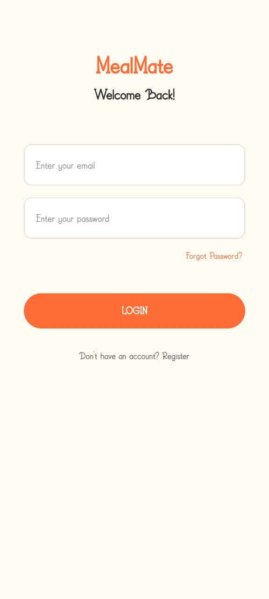
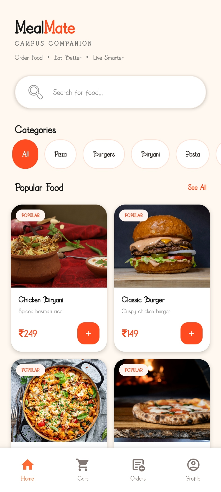
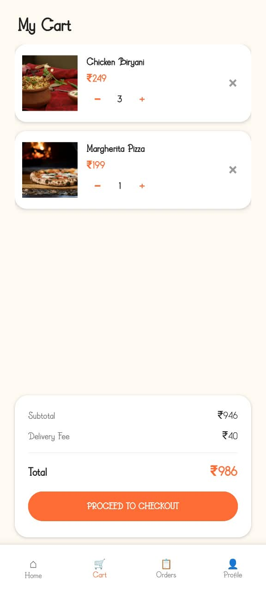
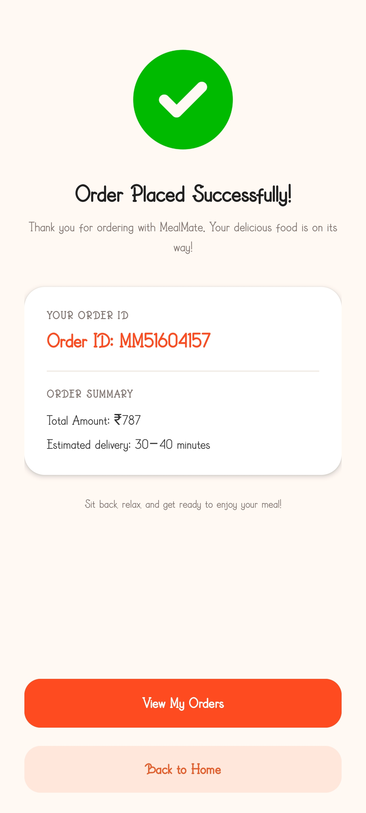

<div align="center">

# 🍔 MealMate

### Campus Companion — Online Food Ordering Android App

**Order Food. Eat Better. Live Smarter.**

An Android food ordering application built with Kotlin, XML, and Firebase.

[](https://developer.android.com/)
[](https://kotlinlang.org/)
[](https://firebase.google.com/)
[](https://github.com/TarangGupta6446/MealMate/releases)

[**Download Latest APK**](https://github.com/TarangGupta6446/MealMate/releases/latest)
·
[View Releases](https://github.com/TarangGupta6446/MealMate/releases)
·
[Report an Issue](https://github.com/TarangGupta6446/MealMate/issues)

</div>

---

## 📖 About the Project

MealMate is an Android food ordering application designed to provide a convenient way to browse food, manage a shopping cart, place orders, and track order status.

The application combines a Kotlin-based Android interface with Firebase Authentication and Cloud Firestore for account and order-related functionality.

## ✨ Features

### 🔐 Authentication
- User registration and login.
- Firebase Authentication integration.
- Persistent login session handling.

### 🍕 Food Browsing
- Browse available food items.
- Search for food.
- Filter food using categories.
- View food details and prices.

### 🛒 Shopping Cart
- Add food items to the cart.
- Increase and decrease item quantities.
- Remove items from the cart.
- Automatically calculate subtotal and total.
- Preserve cart contents locally.

### 📦 Orders
- Checkout and place orders.
- View current and previous orders.
- Track order progress.
- Cancel eligible orders.

### 👤 Profile and Settings
- Manage profile information.
- Access application settings.
- View delivery-related information.

## 📱 App Screenshots

<table>
  <tr>
    <td align="center">
      <strong>🔐 Login Screen</strong><br><br>
      
    </td>
    <td align="center">
      <strong>🍕 Food Menu</strong><br><br>
      
    </td>
  </tr>
  <tr>
    <td align="center">
      <strong>🛒 Checkout</strong><br><br>
      
    </td>
    <td align="center">
      <strong>✅ Order Success</strong><br><br>
      
    </td>
  </tr>
</table>

## 🛠️ Tech Stack

| Technology | Purpose |
|---|---|
| Kotlin | Android application logic |
| XML | Android layouts and UI |
| Android Studio | Development environment |
| Firebase Authentication | User registration and login |
| Cloud Firestore | Cloud-based application data |
| SharedPreferences | Local cart persistence |
| RecyclerView | Displaying lists of food and orders |
| Gradle | Build automation |

## 🏗️ Application Overview

The application follows a screen-based Android architecture with separate activities and reusable UI components.

Main application flow:

1. Splash screen checks the user's authentication session.
2. New users can register, and existing users can log in.
3. Users browse food items and view details.
4. Selected items are added to the shopping cart.
5. Users adjust quantities and proceed to checkout.
6. Orders are stored in Firestore.
7. Users view order status and manage eligible cancellations.

## 🚀 Getting Started

### Prerequisites

- Android Studio.
- Android SDK compatible with the project.
- A Firebase project.
- An Android emulator or physical Android device.

### Installation

1. Clone the repository:

   ```bash
   git clone https://github.com/TarangGupta6446/MealMate.git
   ```

2. Open the project in Android Studio.

3. Create or select your own Firebase project.

4. Register an Android application in Firebase with this package name:

   ```text
   com.example.mealmate
   ```

5. Download your Firebase configuration file:

   ```text
   google-services.json
   ```

6. Place the file inside the `app/` directory.

7. Enable Email/Password authentication in Firebase Authentication.

8. Set up Cloud Firestore and configure appropriate security rules.

9. Sync the project with Gradle.

10. Build and run the application on an Android device or emulator.

## 📥 Download the APK

Get the latest published Android APK from GitHub Releases.

<div align="center">

### [⬇️ Download MealMate for Android](https://github.com/TarangGupta6446/MealMate/releases/latest)

</div>

Download the APK asset attached to the latest release and install it on a compatible Android device.

## 🔒 Security Notes

- Use your own Firebase configuration when setting up the project.
- Do not commit private credentials, service-account keys, or local configuration files.
- Configure Firestore rules to ensure users can only access or modify data they are authorized to use.
- Review the security rules before deploying the application for real customers.

## 🔮 Future Improvements

Potential improvements include:

- Online payment gateway integration.
- Push notifications for order updates.
- Enhanced error handling and loading states.
- Additional automated tests.
- Further accessibility and UI improvements.

## 👨‍💻 Developer

**Tarang Gupta**

GitHub: [@TarangGupta6446](https://github.com/TarangGupta6446)

## 📄 License

No open-source license has been added to this repository yet. All rights remain with the copyright holder unless a license is added.
